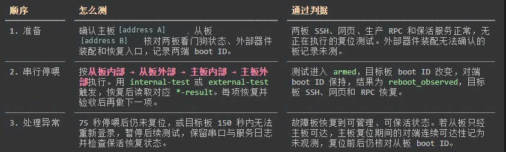

# One Page · Agent Skill

[简体中文](README.md)

**The point isn’t to make AI say less. It’s to know where things stand without reading three paragraphs first.**

For updates to people, answer the question first, in plain text or Markdown. Put any caveat that changes the answer right next to it. Agent-to-agent handoffs keep their existing format.

> **You:** `$one-page` I merged both sales sheets, but two refunds still don’t match an order. Can I send the weekly report?
>
> **AI:** **Not yet.** Those refunds affect net sales. Send me the two original order IDs so I can check the total.

## Install in Codex

Run this in the terminal where you use Codex. If you use WSL, run it inside that distribution.

```sh
git clone --depth 1 --branch v0.2.0 https://github.com/reasonss1/one-page.git "$HOME/.agents/skills/one-page"
```

Open a new session, type `$one-page`, and add your task or notes. No Git? [Download the ZIP](https://codeload.github.com/reasonss1/one-page/zip/refs/tags/v0.2.0) and move the extracted folder containing `SKILL.md` to `~/.agents/skills/one-page/`.

To make this the default for your project, add this line to `AGENTS.md`:

```markdown
Use $one-page for progress updates and results meant for people. Lead with the answer, then give the evidence, blockers, or unverified details that affect it.
```

## From a real chat: a device test plan



Each step sits next to its pass criteria. The screenshot shows what to check, not which tests passed.

## What can you use it for?

| If you want to… | You get… |
|---|---|
| Sort through ideas or to-dos | [A shortlist](references/cards/foundations.md): lay out the options, then filter them by what you want to achieve. |
| Make a report or an old document easier to follow | [A one-page overview](references/cards/documents.md): lead with the conclusion, then show what supports it and what still needs checking. |
| Keep a meeting on track and follow through afterward | [A meeting worksheet](references/cards/meetings.md): separate options, decisions, open questions, and next steps. |
| Plan work or prepare for a negotiation or feedback conversation | [A planning and conversation sheet](references/cards/work.md): mark the workload, fixed deadlines, and what’s negotiable. |
| Set a goal or review how things went | [A goal and review sheet](references/cards/goals.md): explain the trade-offs and choose one action to try. |
| Put what you read into practice | [A learning log](references/cards/learning.md): distinguish what the source says, what you think, and what you’ll try. |

[27 scenario layouts](references/playbook.md) · [Plain-text examples](assets/layouts/plain-text.txt) · [Markdown template](assets/one-page-template.md) (all in Chinese)
