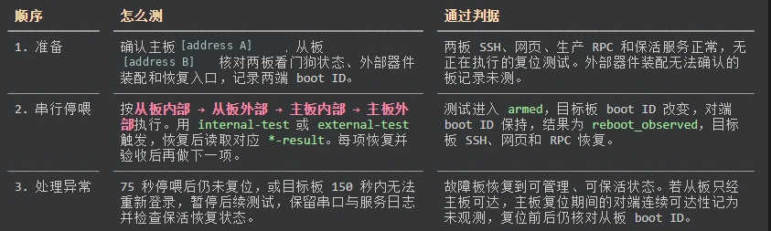

# 一页纸 · Agent Skill

[English](README.en.md)

**不是让 AI 少说几句，是让人不用读完几段，才知道事情到底怎样了。**

用文本或 Markdown 给人汇报：先回答问题，把会改变结论的限制放在旁边。Agent 之间仍按原格式交接。

> **你：** `$one-page` 两张销售表合并了，但有两笔退款没对上原订单。周报能发吗？
>
> **AI：** **先别发。** 这两笔退款会影响净销售额。请补对应的原订单号，我再核对金额。

## 一条命令安装到 Codex

在运行 Codex 的终端执行（用 WSL 就在对应的发行版里执行）：

```sh
git clone --depth 1 --branch v0.2.0 https://github.com/reasonss1/one-page.git "$HOME/.agents/skills/one-page"
```

打开新会话，输入 `$one-page` 并贴上任务或材料。没有 Git？[下载 ZIP](https://codeload.github.com/reasonss1/one-page/zip/refs/tags/v0.2.0)，将解压后含 `SKILL.md` 的文件夹放到 `~/.agents/skills/one-page/`。

想让项目默认这样汇报？把这句放进 `AGENTS.md`：

```markdown
向人汇报进度或结果时，优先使用 $one-page；先给结论，再说影响判断的依据、阻塞或未验证项。
```

## 实际对话：设备自测计划



每一步的「怎么测」和「通过判据」在同一行。这是测试计划，不是通过报告。

## 你可以拿它做什么？

| 如果你想…… | 可以拿到…… |
|---|---|
| 理清一堆想法或待办 | [取舍清单](references/cards/foundations.md)：先列候选，再按目的筛选 |
| 让别人看懂汇报或旧资料 | [一页总览](references/cards/documents.md)：先给结论，再交代依据与待确认项 |
| 开会时不跑题，散会后能接着做 | [会议工作页](references/cards/meetings.md)：候选、已定、未定和下一步 |
| 安排工作、准备协商或反馈 | [计划与沟通页](references/cards/work.md)：标出负荷、固定期限和可商量的事项 |
| 定目标或做复盘 | [目标与复盘页](references/cards/goals.md)：说明取舍，再选一个能试的动作 |
| 把读到的东西用起来 | [学习与记录页](references/cards/learning.md)：区分材料、个人判断和动手试验 |

[查看 27 个场景样式](references/playbook.md) · [纯文本示例](assets/layouts/plain-text.txt) · [Markdown 模板](assets/one-page-template.md)
